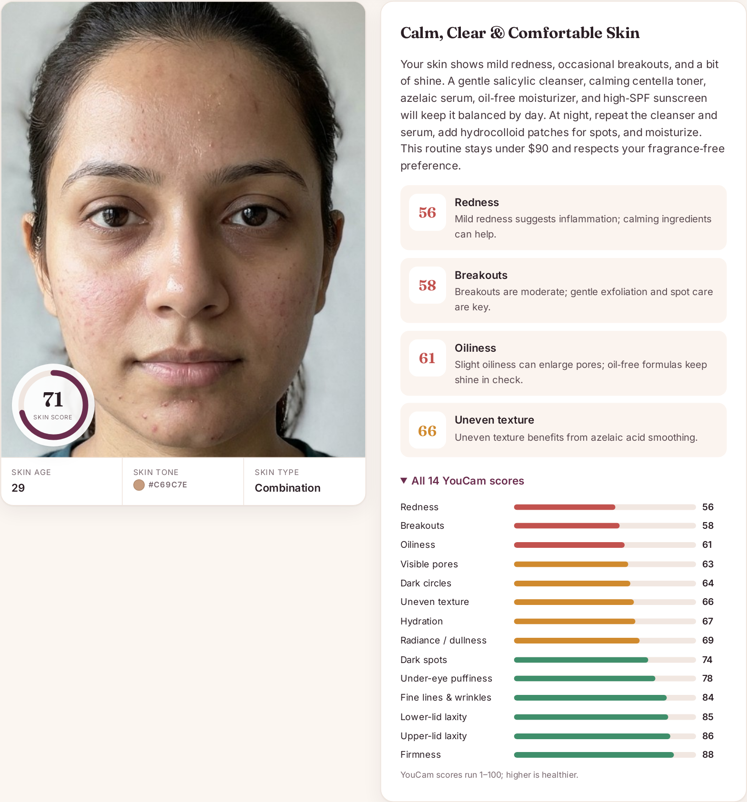
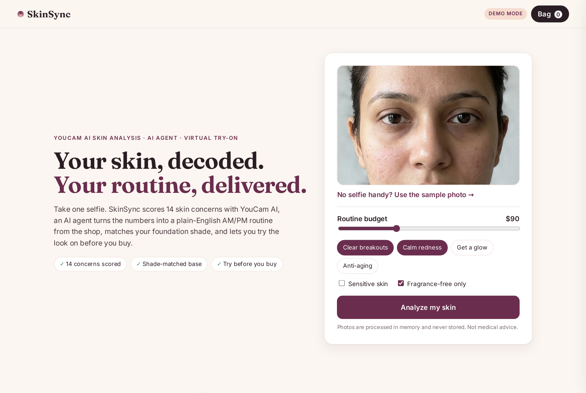
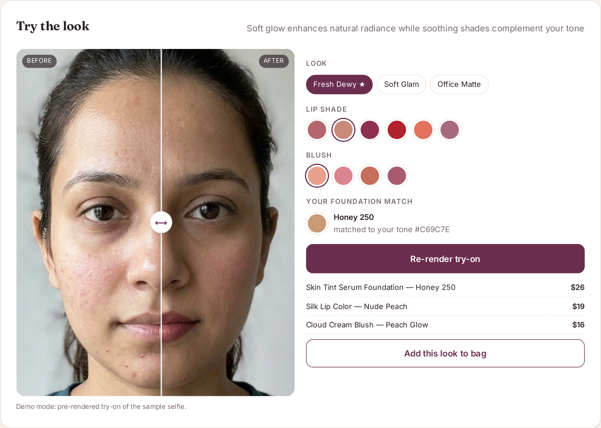
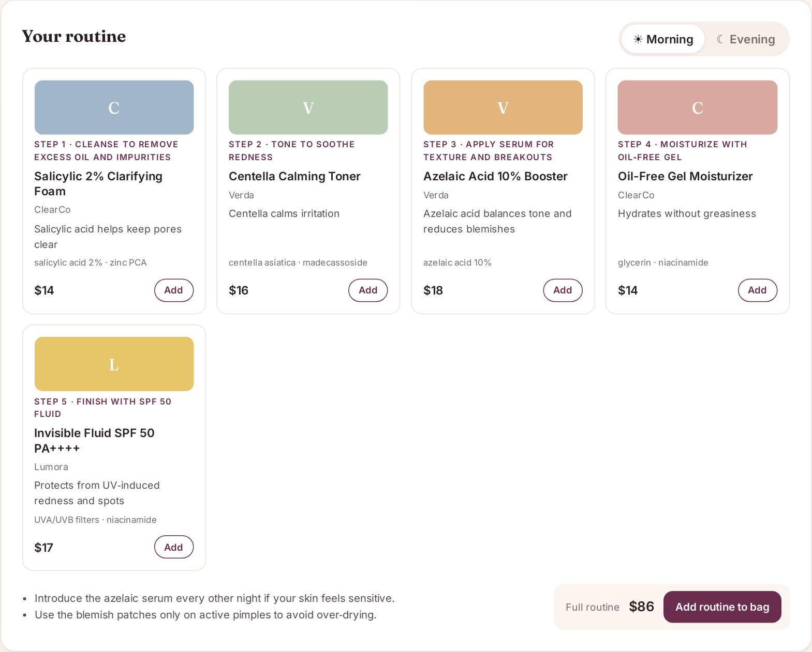

# SkinSync — selfie in, routine out

**SkinSync is an AI skin coach built into a beauty shop.** One selfie goes through **YouCam AI Skin Analysis** (14 concerns scored) and **YouCam Skin Tone Analysis**. An **LLM shopping agent** turns those numbers into plain-English advice, a budget-aware AM/PM routine made from real catalog SKUs, and a shade-matched makeup look. Then **YouCam AI Makeup Virtual Try-On** renders that look on your own face with the exact lipstick, blush and foundation you're about to buy, shown as a before/after slider.

> Built for the *YouCam API Skin AI & eCommerce VTO Hackathon* (Devpost). Track: **Skin AI**, combined with **Makeup VTO**.



| Upload | Try-on | Routine |
|---|---|---|
|  |  |  |

## Why

People don't think about their skin in the abstract. They think about it standing in front of a shelf of 40 serums, or right after a breakout. Skin-analysis apps hand them a score and stop there, and shops hand them a search box. SkinSync connects the two: **diagnosis, explanation, routine, basket and try-on happen in one flow that takes about 20 seconds.**

## Features

- **YouCam Skin Analysis (SD, 14 concerns):** wrinkle, pore, texture, acne, oiliness, radiance, eye bag, age spot, dark circles, upper/lower lid laxity, firmness, moisture and redness. You get an overall score, a skin age, colour-coded bars and per-concern mask links (live mode).
- **YouCam Skin Tone Analysis:** detects the skin colour hex and matches it to the closest foundation shade in the catalog with a weighted RGB distance.
- **Agentic planner (tool calling):** the LLM calls `search_products` with batched catalog queries and shade matching, then `submit_plan`. The server **self-checks the budget**: an over-budget plan goes back to the agent once to be revised. Every product id is validated against the catalog, so hallucinated SKUs are dropped. If the LLM is down or rate-limited, a deterministic rule engine produces the plan instead.
- **Refine in plain English:** for example "I'm pregnant, no retinoids" or "keep it under $60" or "make the look bolder for a party". The agent re-plans and the try-on re-renders.
- **YouCam Makeup VTO:** the chosen look (Fresh Dewy / Soft Glam / Office Matte), lipstick, blush and foundation are compiled into a YouCam `effects` payload (`skin_smooth`, `foundation`, `blush`, `lip_color`). It renders on the user's own photo, with a before/after slider. Shoppers can swap lip and blush shades and re-render.
- **Shop:** add a single product, the full routine or the whole look to the bag. The bag persists in `localStorage`, and checkout is simulated.
- **Transparency:** "How the agent got here" lists every YouCam call and agent tool call.
- **Privacy:** selfies are kept in memory only (a capped in-process session store) and never written to disk.
- **DEMO_MODE:** realistic canned YouCam responses, so the app runs end-to-end without a key.

## Architecture

```
Browser (static/index.html + app.js, no build step)
   │  POST /api/analyze (selfie)     POST /api/plan     POST /api/refine     POST /api/tryon
   ▼
FastAPI (app/main.py)
   ├─ imaging.py   EXIF-fix, JPEG, resize to each feature's limits
   ├─ youcam.py    YouCam v2 client: file → PUT → task → poll   (skin-analysis, skin-tone-analysis, makeup-vto)
   ├─ demo.py      DEMO_MODE stand-ins with the same response shapes
   ├─ agent.py     LLM tool-calling loop (search_products / submit_plan) + budget self-check + rule fallback
   └─ catalog.py   42-SKU demo catalog, shade matching, look → YouCam effects builder
```

## YouCam API usage (v2)

Base URL: `https://yce-api-01.perfectcorp.com` (set with `YOUCAM_BASE_URL`). Auth: `Authorization: Bearer <YOUCAM_API_KEY>`. v2 has no separate auth call.

Every feature uses the same four steps:

| Step | Call |
|---|---|
| 1. Register the upload | `POST /s2s/v2.0/file/{feature}` with `{"files":[{"content_type","file_name","file_size"}]}` returns `file_id` and a pre-signed `requests[0].url` |
| 2. Upload the bytes | `PUT <pre-signed url>` with the headers it returned |
| 3. Start the task | `POST /s2s/v2.0/task/{feature}` with `src_file_id` and feature params, returns `task_id` |
| 4. Poll | `GET /s2s/v2.0/task/{feature}/{task_id}` until `task_status` is `success` or `error` (polled every 2 s, 120 s cap) |

| Feature | Payload SkinSync sends | What it uses from the result |
|---|---|---|
| `skin-analysis` | `dst_actions`: the 14 SD concerns, `format: "json"`, `miniserver_args.enable_mask_overlay: false` | `results.output[] → type, ui_score, raw_score, mask_urls` (the ZIP `score_info.json` shape is also supported) |
| `skin-tone-analysis` | `face_angle_strictness_level: "medium"` | `results.color.skin_color` (plus eye/hair colour) |
| `makeup-vto` | `version: "1.0"`, `effects: [skin_smooth, foundation, blush(pattern 1color1), lip_color(shape original, style full)]` | `results.url` (the rendered image) |

Image prep follows the documented limits: skin analysis SD needs a short side of at least 480 px and a long side of at most 4096 px, and makeup VTO needs width under 1920 and height under 1080. YouCam errors such as `error_src_face_too_small` reach the UI unchanged.

## Run locally

```bash
python -m venv .venv && source .venv/bin/activate
pip install -r requirements.txt
cp .env.example .env            # optional: add YOUCAM_API_KEY and LLM_API_KEY
uvicorn app.main:app --reload --port 8000
# open http://localhost:8000 and click "Use the sample photo"
```

- No `YOUCAM_API_KEY` means **DEMO_MODE** turns on automatically. You can also force it with `DEMO_MODE=true`.
- No `LLM_API_KEY` (or LLM errors) means the rule-based planner runs, so the app still works.
- Any OpenAI-compatible LLM works. The default is Groq `openai/gpt-oss-120b`. Groq's free tier allows about 8k tokens per minute, which is roughly one plan every 20–30 s.

Docker: `docker build -t skinsync . && docker run -p 8000:8000 --env-file .env skinsync`

Render: the `render.yaml` blueprint is included. Set `YOUCAM_API_KEY` and `LLM_API_KEY` in the dashboard.

## Tests

```bash
pip install -r requirements-dev.txt
pytest -q
```

The tests cover the full demo flow (analyze, plan, try-on, images), upload validation, both YouCam result shapes, the live YouCam client contract (mocked with `respx`: Bearer header, file→PUT→task→poll, payload shape), YouCam task-error propagation, dropping hallucinated SKUs, foundation shade matching, and the refine fallback.

## Environment variables

| Var | Default | Purpose |
|---|---|---|
| `YOUCAM_API_KEY` | — | YouCam v2 API key ([console](https://yce.perfectcorp.com/api-console/en/api-keys/)) |
| `YOUCAM_BASE_URL` | `https://yce-api-01.perfectcorp.com` | API host |
| `DEMO_MODE` | on if no key | Canned YouCam responses |
| `LLM_API_KEY` / `LLM_BASE_URL` / `LLM_MODEL` | Groq / `openai/gpt-oss-120b` | Agent LLM |
| `LLM_ENABLED` | `true` | `false` forces the rule planner |

## Notes and limits

- The catalog (`data/catalog.json`) uses **fictional brands** for the prototype. You can swap in a real merchant feed without code changes as long as it keeps the same fields.
- Cosmetic guidance only, not a medical diagnosis. The agent is told to suggest a dermatologist for persistent or painful conditions.
- In DEMO_MODE the sample selfie's "after" image is pre-rendered, and uploaded photos get an approximate filter preview. Real makeup placement needs a YouCam key.
- The sample selfie is an AI-generated face, not a real person.

## License

MIT, see [LICENSE](LICENSE). Bundled fonts: Fraunces and Inter (SIL Open Font License).
